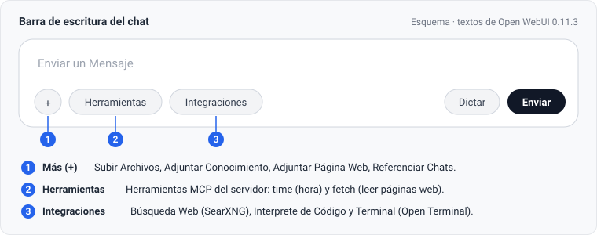
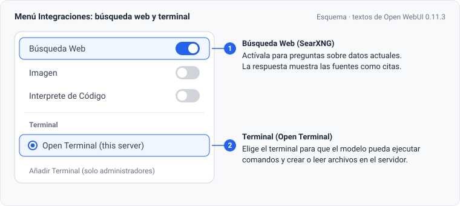
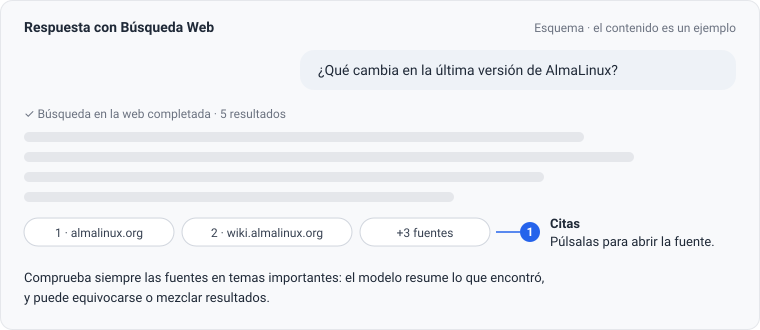
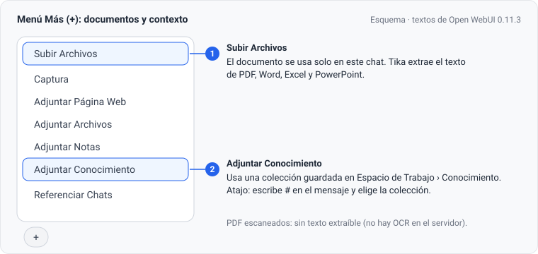
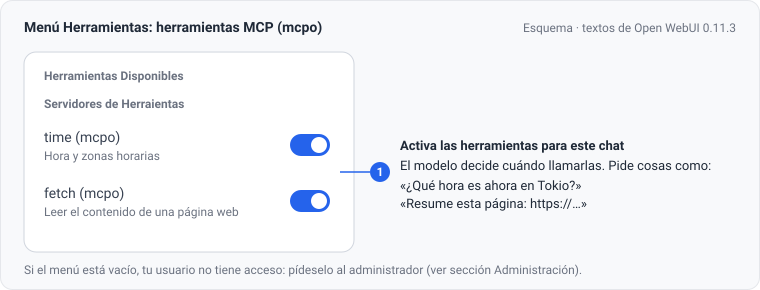
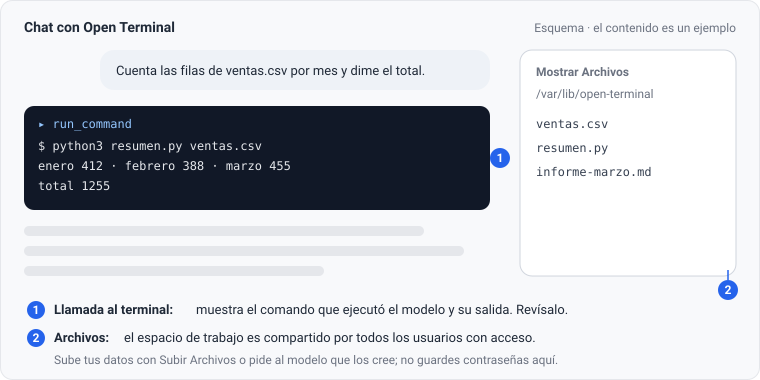
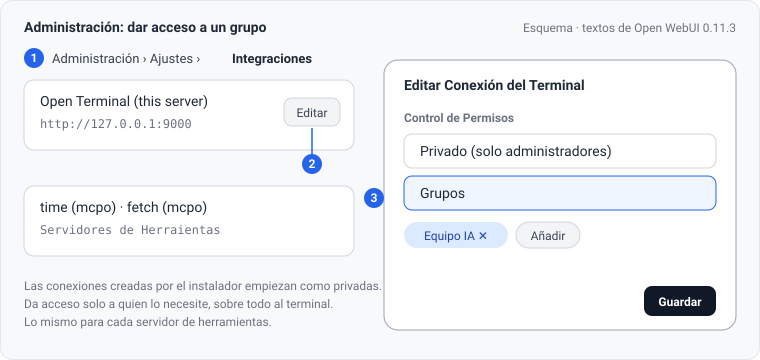
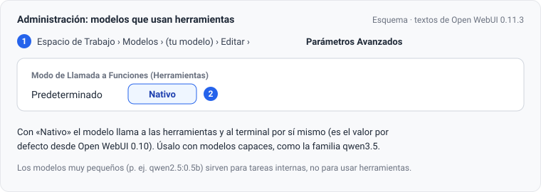
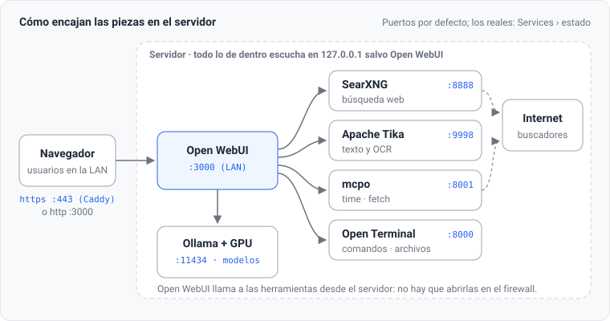

# Guía de uso de las herramientas de Open WebUI

Esta guía explica cómo usar en el chat las herramientas que el instalador añade a Open WebUI: búsqueda en internet, lectura de documentos, hora y lectura de páginas web, y el terminal. La última sección es para quien administra el servidor.

> Las imágenes son esquemas, no capturas. Usan los textos exactos de Open WebUI 0.11.3 en español, incluidas algunas erratas de su traducción (por ejemplo «Servidores de Herraientas»). La apariencia real puede variar con la versión.

## Qué herramientas hay

| Herramienta | Para qué sirve | Dónde se activa |
|---|---|---|
| **Búsqueda Web** (SearXNG) | Preguntas sobre información actual, con las fuentes citadas | Integraciones › Búsqueda Web |
| **Documentos** (Apache Tika) | Hacer preguntas sobre PDF, Word, Excel y PowerPoint | Más (+) › Subir Archivos o Adjuntar Conocimiento |
| **time** (mcpo) | Hora actual y conversiones entre zonas horarias | Herramientas |
| **fetch** (mcpo) | Leer y resumir una página web concreta | Herramientas |
| **Terminal** (Open Terminal) | Ejecutar comandos, analizar datos, crear y modificar archivos | Integraciones › Terminal |

Todas funcionan dentro del servidor. Tus documentos y conversaciones no salen de él; solo las búsquedas web y las páginas que pidas leer viajan a internet.

## Antes de empezar

- **Las herramientas se activan en cada chat**, desde la barra de escritura. Un chat nuevo empieza sin ellas.
- **Elige un modelo capaz.** Para usar herramientas y el terminal funcionan bien los modelos de la familia qwen3.5. Los modelos muy pequeños no saben usarlas.
- **Si no ves «Herramientas» o el terminal**, tu usuario no tiene acceso todavía. Pídeselo al administrador.

## 1. Buscar en internet

1. Abre **Integraciones** en la barra de escritura.
2. Activa **Búsqueda Web**.
3. Escribe tu pregunta como siempre.

El modelo genera las consultas, lee los mejores resultados (5 por defecto) y responde citando las fuentes.

Ejemplos que funcionan bien:

- «¿Qué novedades trae la última versión de AlmaLinux? Resúmelas en una lista.»
- «Compara los precios actuales de las tarjetas RTX 4060 y RTX 3060 en tiendas españolas.»
- «¿Qué dice la documentación oficial de Python sobre `asyncio.TaskGroup`?»

Consejos:

- **Sé concreto**: indica el periodo («este año», «la última versión»), el país o el tipo de fuente que prefieres.
- **Comprueba las fuentes** en temas importantes. Pulsa una cita para abrirla: el modelo resume lo que encontró y puede equivocarse.
- **No pongas datos confidenciales** en una pregunta con la búsqueda activada: las consultas se envían a buscadores públicos (de forma anónima, a través de SearXNG).
- Desactiva la búsqueda cuando no la necesites; las respuestas serán más rápidas.

## 2. Trabajar con documentos

Hay dos formas de usar documentos:

| | Subir Archivos | Adjuntar Conocimiento |
|---|---|---|
| Para qué | Un documento para la conversación actual | Una colección de documentos que reutilizas a menudo |
| Cómo | Más (+) › **Subir Archivos**, o arrastra el archivo al chat | Créala en **Espacio de Trabajo › Conocimiento** y en el chat usa Más (+) › **Adjuntar Conocimiento**, o escribe **#** y elígela |
| Dura | Solo en ese chat | Hasta que la borres; se puede compartir con otros usuarios |

Formatos: PDF, Word, Excel, PowerPoint, texto, Markdown, CSV y similares. Apache Tika extrae el texto en el servidor.

Ejemplos:

- «¿Qué plazo de entrega fija el contrato adjunto y qué penalización hay si se incumple?»
- «Haz una tabla con los importes por trimestre que aparecen en el informe.»
- «#manual-procedimientos ¿Cuál es el procedimiento para dar de alta a un proveedor?»

Ten en cuenta:

- **El modelo no lee el documento entero de golpe**: busca los 5 fragmentos más relacionados con tu pregunta. Pregunta por temas concretos. Para resumir un documento largo, pide el resumen por capítulos o secciones.
- **Los PDF escaneados no funcionan**: son imágenes y el servidor no tiene OCR. Pasa el documento por un programa con OCR antes de subirlo, o pega el texto.
- Si una respuesta no encaja con el documento, pide al modelo que cite el fragmento en el que se basa.

## 3. Hora y lectura de páginas (herramientas MCP)

1. Abre **Herramientas** en la barra de escritura.
2. Activa **time (mcpo)**, **fetch (mcpo)** o las dos.
3. Pide lo que necesites; el modelo decide cuándo usarlas.

| Herramienta | Ejemplos |
|---|---|
| time | «¿Qué hora es ahora en Tokio?» · «Si son las 10:00 en Madrid, ¿qué hora es en Nueva York?» |
| fetch | «Resume esta página: https://…» · «Lee esta noticia y dime qué cifras da: https://…» |

**fetch o Búsqueda Web:**

- Usa **fetch** cuando ya tienes la dirección de la página.
- Usa **Búsqueda Web** cuando quieres que el modelo encuentre las páginas.
- Puedes combinarlas: busca con la Búsqueda Web y después pide «lee a fondo la segunda fuente».

fetch no puede leer páginas que piden inicio de sesión ni las que bloquean la lectura automática.

## 4. El terminal (Open Terminal)

Con el terminal, el modelo puede ejecutar comandos en el servidor: analizar un CSV con Python, convertir formatos, generar un informe o un gráfico y guardarlo como archivo.

1. Abre **Integraciones** y, en **Terminal**, elige **Open Terminal (this server)** (ver la imagen de la sección 1).
2. Pide la tarea con detalle: qué datos, qué resultado y en qué formato.
3. Revisa cada llamada al terminal: muestra el comando que ejecutó el modelo y su resultado.

Ejemplos:

- «Sube ventas.csv (adjunto). Calcula el total por mes con Python y guarda el resultado en resumen.csv.»
- «Convierte informe.md a HTML y dime cuántas palabras tiene.»
- «Crea un gráfico de barras con los datos de resumen.csv y guárdalo como grafico.png.»

Con **Mostrar Archivos** ves y descargas los archivos del espacio de trabajo.

Qué puede hacer y qué no:

| Puede | No puede |
|---|---|
| Ejecutar comandos y programas de Python | Usar `sudo` ni instalar paquetes del sistema |
| Crear, leer y modificar archivos en su espacio de trabajo | Escribir fuera de su espacio de trabajo |
| Usar Python 3 e instalar paquetes para sí mismo (`pip install --user pandas`) | Ver las carpetas personales de `/home` ni los procesos de otros servicios |
| Descargar datos de internet | Acceder a las claves de las demás herramientas |

**Importante:**

- **El espacio de trabajo es compartido** por todos los usuarios con acceso al terminal. Cualquiera de ellos puede ver tus archivos. No dejes datos confidenciales y borra lo que ya no necesites.
- **No escribas contraseñas ni claves** en el chat ni en archivos del terminal.
- **Revisa lo que hace el modelo** antes de usar sus resultados, sobre todo si modifica o borra archivos.

## Combinaciones útiles

| Combinación | Ejemplo |
|---|---|
| Búsqueda Web + fetch | «Busca la guía oficial de instalación de X y luego lee la primera fuente a fondo.» |
| Documento + terminal | Sube un Excel y pide: «calcula las medias por columna y genera un gráfico». |
| Conocimiento + Búsqueda Web | «#politica-interna ¿Cumple nuestra política con lo que exige la normativa publicada este año?» |

## Problemas frecuentes

| Qué pasa | Por qué | Qué hacer |
|---|---|---|
| No veo «Herramientas» o el terminal | Tu usuario no tiene acceso | Pídeselo al administrador |
| El modelo no usa la herramienta | Modelo demasiado pequeño, o la herramienta no está activada en este chat | Usa un modelo de la familia qwen3.5 y comprueba el menú; dile explícitamente «usa la herramienta fetch» |
| La búsqueda no devuelve nada | Pregunta muy genérica, o el servicio de búsqueda está caído | Concreta la pregunta; si sigue fallando, avisa al administrador |
| El documento «no tiene texto» | PDF escaneado | Pásalo por OCR o pega el texto |
| La respuesta ignora parte del documento | El modelo solo ve los fragmentos más relevantes | Pregunta por secciones concretas |
| La respuesta se corta o el chat da error con mucho texto | Se superó el contexto del modelo | Empieza un chat nuevo o adjunta menos documentos a la vez |

## Para el administrador

### Dar acceso a usuarios

Las conexiones que crea el instalador son **privadas**: solo las ven los administradores. Para que otros usuarios usen el terminal o las herramientas MCP, da acceso a un grupo:

1. **Administración › Ajustes › Integraciones**.
2. En la conexión, pulsa **Editar**.
3. En **Control de Permisos**, elige el grupo y guarda.

Los grupos se gestionan en **Administración › Usuarios › Grupos**. Da acceso al terminal solo a quien lo necesite: ejecuta comandos en el servidor y su espacio de trabajo es compartido. Si reconectas las herramientas con el instalador, los permisos que hayas dado se conservan.

La extracción de documentos funciona para todos los usuarios. La Búsqueda Web también está permitida por defecto; puedes limitarla por grupo en los permisos de cada grupo.

### Modelos que usan herramientas

En **Espacio de Trabajo › Modelos › (modelo) › Editar › Parámetros Avanzados**, deja **Modo de Llamada a Funciones (Herramientas)** en **Nativo**. Es el valor por defecto desde Open WebUI 0.10, pero conviene comprobarlo en los modelos que hayas personalizado.

### Qué hay detrás

- Las herramientas escuchan solo en `127.0.0.1` y Open WebUI las llama desde el propio servidor, así que no hace falta abrir sus puertos en el firewall.
- Los puertos del esquema son los de por defecto. Los reales están en `7) Services › Show status of all services` (columna `LISTEN`) o con `sudo /usr/local/bin/xemi_ai_install.sh services`.

### Mantenimiento con el instalador

| Tarea | Menú | Comando |
|---|---|---|
| Estado, puertos y salud de los servicios | 7) Services › Show status of all services | `services` |
| Comprobación general (incluye herramientas y aislamiento) | 8) Diagnostics › Run doctor readiness check | `doctor` |
| Conectar o reconectar las herramientas a Open WebUI | 5) Open WebUI tools › Connect installed tools to Open WebUI | `tools-connect` |
| Actualizar las herramientas y su aislamiento | 5) Open WebUI tools › Update installed tools | `tools-update` |
| Modelo de tareas, Top K y número de resultados | 4) Open WebUI › Apply recommended settings | — |
| Contexto y caché de los modelos | 2) Ollama › Tune model memory | `ollama-tune` |
| Uso de GPU y modelos cargados | 7) Services › GPU usage | `gpu` |

Los comandos se ejecutan como `sudo /usr/local/bin/xemi_ai_install.sh <comando>`.

### Documentos en español: modelo de incrustación

En instalaciones nuevas, el instalador configura un modelo multilingüe para buscar dentro de los documentos. En instalaciones anteriores puede seguir el modelo original, pensado para inglés. Para cambiarlo:

1. **Administración › Ajustes › Documentos › Modelo de Incrustación**: `sentence-transformers/paraphrase-multilingual-MiniLM-L12-v2`.
2. Reindexa el conocimiento existente cuando Open WebUI lo pida. Los documentos indexados con el modelo anterior no se encuentran bien con el nuevo hasta reindexarlos.

### Seguridad

- **Terminal:** se ejecuta como el usuario `aiterminal`, sin `sudo`, con el sistema en solo lectura y sin ver los procesos de otros usuarios. Aun así, ejecuta lo que el modelo decida: limita el acceso a usuarios de confianza.
- **Claves:** las claves de Open Terminal y mcpo están en `/etc/xemi-ai/` (solo root). Open WebUI las guarda en su base de datos al conectar.
- **Ollama:** si `doctor` avisa de que escucha en todas las interfaces y nadie lo usa fuera de Open WebUI, cámbialo a `127.0.0.1` en `2) Ollama › Configure Ollama service for LAN`.
